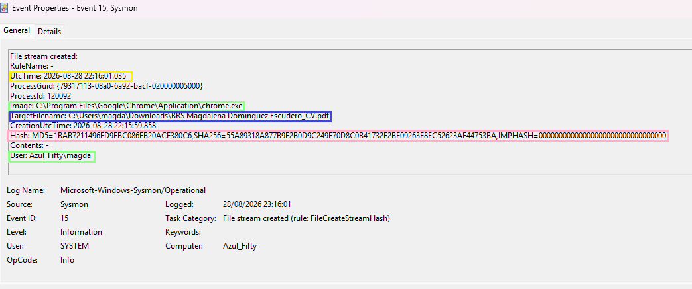

# 💿 Sysmon Event ID 15 FileStreamCreated  
### Alternate Data Streams (ADS) Investigation Chrome Download

This evidence captures a **benign Alternate Data Stream (ADS)** creation event generated by **Google Chrome** when downloading a PDF file.  
Sysmon flags this behaviour under **Event ID 15  FileStreamCreated**, which is commonly associated with **defence evasion** techniques such as hiding payloads inside ADS.  
In this case, the activity is legitimate and expected.

---

## 📸 Evidence Screenshot (EVENT15)

---

## 🔍 Highlighted Indicators (Why This Event Is Benign)

### 🟩 1. Legitimate Process (chrome.exe)  
The process creating the ADS is Google Chrome:  
`C:\Program Files\Google\Chrome\Application\chrome.exe`  
This is a trusted browser and a standard installation path.

### 🟦 2. Expected ADS: Zone.Identifier  
The target file stream is:  
`BRS Magdalena Dominguez Escudero_CV.pdf:Zone.Identifier`  
`Zone.Identifier` is a **Mark-of-the-Web (MOTW)** stream automatically added by Windows to files downloaded from the internet.  
It is used by SmartScreen and Office sandboxing.

### 🟨 3. Normal Download Behaviour  
Chrome creates the ADS to mark the file as originating from the internet.  
This allows Windows to apply security controls such as:  
- blocking macros  
- warning dialogs  
- sandboxing  
- SmartScreen checks

### 🟩 4. User Context (Interactive Session)  
`User: Azul_Fifty\magda`  
The process runs under your normal user account.  
No privilege escalation or impersonation.

### ⬜ 5. No Suspicious Stream Name  
Malicious ADS often use names like:  
- `:evil`  
- `:payload`  
- `:hidden`  
- `:enc`  
- `:malware`  
Your stream is the standard MOTW identifier.

---

## 🔹 Event Summary

Sysmon Event ID 15 is triggered when a process creates a **file stream**, typically an **Alternate Data Stream (ADS)**.  
In this case, Chrome created the `Zone.Identifier` ADS for a downloaded PDF file.

This behaviour is **normal** and part of Windows’ security model.

---

## 🔹 Evidence Extract (Sysmon Event ID 15)

**Process:**  
`C:\Program Files\Google\Chrome\Application\chrome.exe`

**Target file stream:**  
`C:\Users\magda\Downloads\BRS Magdalena Dominguez Escudero_CV.pdf:Zone.Identifier`

**Timestamp:**  
`CreationUtcTime: 2026-08-28 22:15:59.858`

**User:**  
`Azul_Fifty\magda`

---

## 🔹 What Are Alternate Data Streams (ADS)?

ADS are a feature of the NTFS filesystem that allow files to contain **multiple data streams**.  
They are often used for:

- metadata  
- browser download markers  
- application state  
- security tagging  

But attackers may abuse ADS to:

- hide payloads  
- bypass AV  
- store scripts invisibly  
- evade detection

---

## 🔹 Benign vs Malicious ADS

### ✔ Benign (your case)
- Stream name: `Zone.Identifier`  
- Process: Chrome  
- File type: PDF  
- Purpose: Mark-of-the-Web  
- No hidden payload  
- No execution

### ❌ Malicious examples
- `calc.exe:hidden`  
- `payload.dll:evil`  
- `script.ps1:enc`  
- `file.txt:malware`  
- ADS containing executable content  
- ADS created by PowerShell, cmd, wscript, mshta, regsvr32, rundll32

---

## 🔹 SOC Triage Assessment

### ✔ Indicators of benign activity
- Trusted process (Chrome)  
- Expected ADS (Zone.Identifier)  
- Normal user context  
- No suspicious stream name  
- No execution or access of the ADS  
- No correlation with Sysmon Event ID 1, 8, 10, 11

### ✔ No signs of anti‑forensics  
The ADS is used for security tagging, not hiding data.

---

## 🔹 MITRE ATT&CK Mapping
* **Tactic:** TA0005 - Defense Evasion
* **Technique:** T1564 - Hide Artifacts
* **Sub-technique:** T1564.004 - NTFS File Attributes

*Context:* While this specific Event ID 15 captures the benign creation of a `Zone.Identifier` stream (Mark-of-the-Web) by a web browser, attackers frequently abuse Alternate Data Streams (ADS) to conceal malicious payloads and bypass static defenses (T1564.004). Triaging this telemetry is essential for tuning SOC alerts and distinguishing legitimate browser metadata from hidden malicious artifacts.

---

## 📝 My  Notes

This case demonstrates how browsers legitimately create Alternate Data Streams during file downloads.  
Understanding this behaviour helps SOC analysts distinguish between:

- **normal MOTW tagging**  
- **malicious ADS payload hiding**

This evidence strengthens your portfolio by showing your ability to triage ADS events correctly.

---

### **Authored by**  
**Magda Dominguez**  
Security Operations • Detection Engineering • Blue Team
