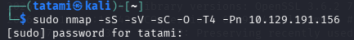
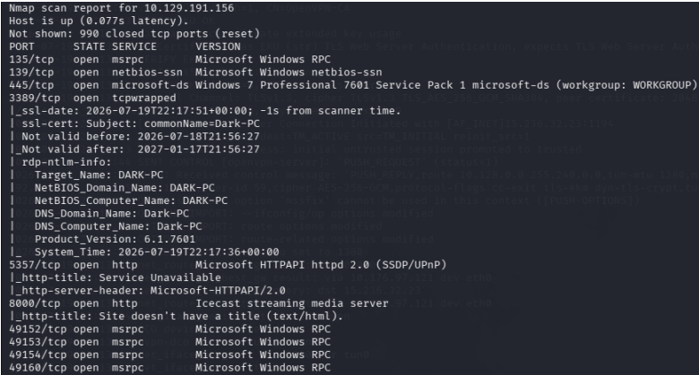

# Incident Report: Active Network Reconnaissance (Nmap SYN Scan)

  
  
  
  

## 🔹 Executive Summary
During routine network monitoring, anomalous active scanning activity was detected targeting the host at IP address `10.129.191.156`. Analysis of the telemetry reveals that a threat actor (or internal auditor) executed an aggressive active reconnaissance scan using **Nmap** to map the attack surface, discover critical services, and profile the operating system. 

This report documents the network evasion techniques utilised during the reconnaissance, the metadata exposed by the target host, and recommendations for improving perimeter detection.

## 🔹 Triage & Command Analysis
Network forensic analysis and command logs reveal the exact execution used to probe the server:

`sudo nmap -sS -sV -sC -O -T4 -Pn 10.129.191.156`

*(Reconstruction of the Nmap scan execution against the target).*

**Breakdown of the scanning tactic (Blue Team Perspective):**
*   **`-sS` (SYN Stealth Scan):** The attacker utilised a TCP SYN scan to avoid completing the Three-Way Handshake. This sends a SYN packet and, upon receiving a SYN/ACK, terminates the connection with an RST packet, preventing full connections from being logged by standard applications.
*   **`-Pn` (No Ping):** ICMP host discovery probes were disabled. The attacker assumed the host was online to evade firewall rules that block ICMP echo requests (ping).
*   **`-T4` (Aggressive Timing):** Accelerates the scan to map the network rapidly. In a properly configured SOC environment, this rapid burst of packets should immediately trigger alerts on the IDS/IPS (e.g., Suricata or Snort).
*   **`-sV` & `-sC` & `-O`:** Enabled service version detection, default enumeration scripts, and OS fingerprinting to extract the maximum amount of intelligence from the target.

## 🔹 Exposed Attack Surface (Impact)
The reconnaissance successfully extracted critical system information (0.077s latency), identifying 10 open TCP ports and successfully profiling the machine.

*(Capture of the discovered ports and Nmap reconnaissance scripts).*

**Intelligence gathered by the attacker:**
1.  **Host Identity:** SMB and RDP enumeration scripts revealed that the machine's hostname is `DARK-PC` and that it is joined to a default workgroup named `WORKGROUP`.
2.  **Obsolete Operating System:** OS fingerprinting confirmed the system is running **Windows 7 Professional 7601 Service Pack 1** (x64 architecture), a highly vulnerable End-of-Life (EoL) operating system.
3.  **Exposed Critical Services:**
    *   **Port 445 (SMB):** Exposed for file sharing, vulnerable to multiple exploits on Windows 7 versions.
    *   **Port 3389 (RDP):** Remote Desktop Service. The attacker managed to force an authentication exchange that leaked system metadata.
    *   **Port 8000 (Icecast):** Running an Icecast streaming media server. Outdated versions of this service represent critical exposure points, carrying a high risk of Remote Code Execution (RCE) vulnerabilities.
    *   **RPC Ports (135, 49152-49160):** Dynamic port allocation for system management.

## 🔹 MITRE ATT&CK Mapping

| Tactic | Technique | ID | Context |
| :--- | :--- | :--- | :--- |
| **Reconnaissance** | Active Scanning: Scanning IP Blocks | [T1595.001](https://attack.mitre.org/techniques/T1595/001/) | Direct scan with Nmap (`-sS`) to identify active ports and services. |
| **Reconnaissance** | Active Scanning: Vulnerability Scanning | [T1595.002](https://attack.mitre.org/techniques/T1595/002/) | Use of Nmap scripts (`-sC`, `-sV`) to extract exact OS versions (Windows 7) and vulnerable services (Icecast). |

## 🔹 Defensive Recommendations (SOC)
1.  **Network Detection (IDS/IPS):** Implement and fine-tune Intrusion Detection System rules to alert on rapid burst scans (e.g., thresholds for incomplete TCP SYN connections) originating from a single source IP.
2.  **Attack Surface Reduction:** Strictly restrict access to management ports (SMB 445, RDP 3389) via network firewalls. These services should never be exposed publicly or on untrusted subnets without a prior VPN connection.
3.  **Vulnerability Management:** Immediately isolate or upgrade the Windows 7 system (DARK-PC), as EoL systems represent an unacceptable risk within a corporate network.

---
### 👩🏽‍💻 *Authored by: Magda Dominguez*  
*Security Operations • Detection Engineering • Blue Team*